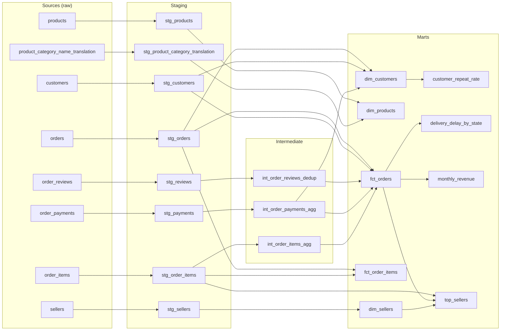
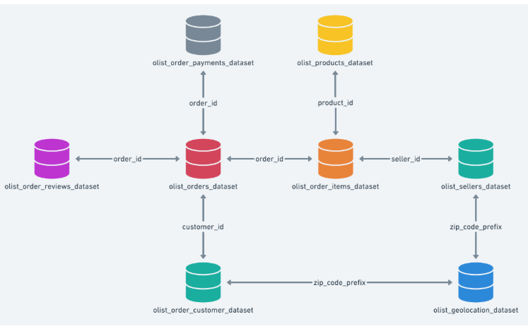

# Olist E-Commerce Analytics

An end-to-end analytics engineering project on real Brazilian e-commerce data: raw CSVs are loaded into **PostgreSQL**, modelled and tested with **dbt**, and explored in a **Streamlit** dashboard. The whole stack runs with Docker Compose.

> **Status:** ETL and dbt models are complete (20 models, 110 tests). The Streamlit dashboard is in progress.

## Key insights

| # | Finding | Model |
|---|---|---|
| 1 | **Late deliveries wreck reviews.** Late orders average **2.27 stars**, on-time orders **4.29**. | `fct_orders` |
| 2 | **Almost nobody comes back.** Only **3.12%** of customers (2,997 of 96,096) ever place a second order. | `customer_repeat_rate` |
| 3 | **The north-east waits longest.** In Alagoas (AL), **21.4%** of orders arrive late and delivery takes **24.5 days** on average, against 6.8% late and 12.5 days nationally. | `delivery_delay_by_state` |
| 4 | **Black Friday is the peak.** November 2017 was the best month at **R$1.17M**, up **53%** on October. | `monthly_revenue` |
| 5 | **Top revenue ≠ top quality.** The #1 seller by revenue ranks **#667 of 1,259** on review score. | `top_sellers` |

## Business questions

Olist is a marketplace that connects small sellers to large online storefronts. This project answers:

| Question | dbt model |
|---|---|
| How is revenue trending month over month? | `monthly_revenue` |
| Which regions receive orders late, and by how many days? | `delivery_delay_by_state` |
| Who are the best and worst sellers by revenue and review score? | `top_sellers` |
| How many customers buy more than once? | `customer_repeat_rate` |

## Architecture

```text
 Kaggle CSVs ──► ETL (Python) ──► Postgres `raw` schema ──► dbt ──► staging ► intermediate ► marts ──► Streamlit
                 Extract + Load                            Transform                                  Dashboard
```

| Service | Role |
|---|---|
| `postgres` | Warehouse (Postgres 15) |
| `etl` | One-off job that loads the raw CSVs into the `raw` schema (idempotent: unchanged files are skipped) |
| `dbt` | One-off job that runs `dbt deps && dbt build` (models + tests) |
| `streamlit` | Dashboard on top of the marts, at <http://localhost:8501> |

## dbt lineage

Generated from dbt's `manifest.json`:



| Layer | Models | Materialized as | Job |
|---|---|---|---|
| Staging | 8 | views | 1:1 with raw tables: rename, cast types, no joins |
| Intermediate | 3 | views | Roll payments, items and reviews up to one row per order to prevent join fan-out |
| Marts | 9 | tables | `fct_orders`, `fct_order_items` (incremental), 3 dimensions, 4 reporting marts |

**dbt features used:** sources and `ref()`, generic and singular tests, a custom macro (`delivery_days`), a Jinja `` loop (payment-type pivot), an incremental model with `delete+insert`, and a custom `generate_schema_name`.

## Testing

110 tests run on every `dbt build`:

- **Generic tests (YAML):** `unique` and `not_null` on every primary key, `accepted_values` on statuses, payment types and review scores, and `relationships` between models.
- **Singular tests (SQL, in `dbt/tests/`):** check that aggregations lose no data, that `fct_orders` has exactly one row per order, that reports add up to the fact table, and that the incremental model never duplicates rows.
- **Business rule (warns, doesn't fail):** payments should equal item prices + freight. 303 orders (0.3%) differ, mostly by installment interest.

## Dataset

[Brazilian E-Commerce Public Dataset by Olist](https://www.kaggle.com/datasets/olistbr/brazilian-ecommerce): about 99k anonymised orders from 2016 to 2018 across 9 related tables.



## Getting started

**Prerequisites:** Docker with Docker Compose.

1. Clone the repo and download the dataset from Kaggle. Unzip it anywhere inside `data/` (the folder is gitignored).
2. Create your env file and set a password:

   ```bash
   cp .env.example .env
   ```

3. Start the stack:

   ```bash
   docker compose up --build
   ```

4. Open the dashboard at <http://localhost:8501>. Postgres is available on `localhost:5432` (or `POSTGRES_HOST_PORT` from `.env`).

### Useful commands

```bash
# Re-run dbt after changing models (skip re-running the ETL with --no-deps)
docker compose run --rm --no-deps dbt dbt build

# Build one model and everything downstream of it
docker compose run --rm --no-deps dbt dbt build --select fct_orders+

# Rebuild the incremental model from scratch
docker compose run --rm --no-deps dbt dbt run --full-refresh --select fct_order_items

# Browse the docs and the interactive lineage graph at http://localhost:8080
docker compose run --rm --no-deps -p 8080:8080 dbt sh -c "dbt docs generate && dbt docs serve --host 0.0.0.0 --port 8080 --no-browser"

# Query the warehouse
docker exec -it olist-postgres psql -U olist -d olist
```

## Project structure

```text
├── docker-compose.yml
├── .env.example
├── docker/              # one Dockerfile per service (dbt, etl, streamlit)
├── data/                # raw Kaggle CSVs (gitignored)
├── docs/                # diagrams and screenshots
├── etl/                 # Python loader: CSVs -> raw schema via COPY
├── dbt/                 # dbt project
│   ├── dbt_project.yml
│   ├── profiles.yml     # reads credentials from env vars
│   ├── macros/          # delivery_days, generate_schema_name
│   ├── tests/           # singular SQL tests
│   └── models/
│       ├── staging/     # 1:1 cleaned views of the raw tables
│       ├── intermediate/# one-row-per-order rollups
│       └── marts/       # facts, dimensions and reporting tables
└── streamlit/           # dashboard app
```

## Tech stack

PostgreSQL 15 · dbt Core 1.12 (`dbt-postgres`) · Python (psycopg2) · Streamlit · Docker Compose

## Learn more

[PROJECT_OVERVIEW.md](PROJECT_OVERVIEW.md) covers the full plan: modelling layers, data quirks in the dataset, the testing approach and the roadmap.
